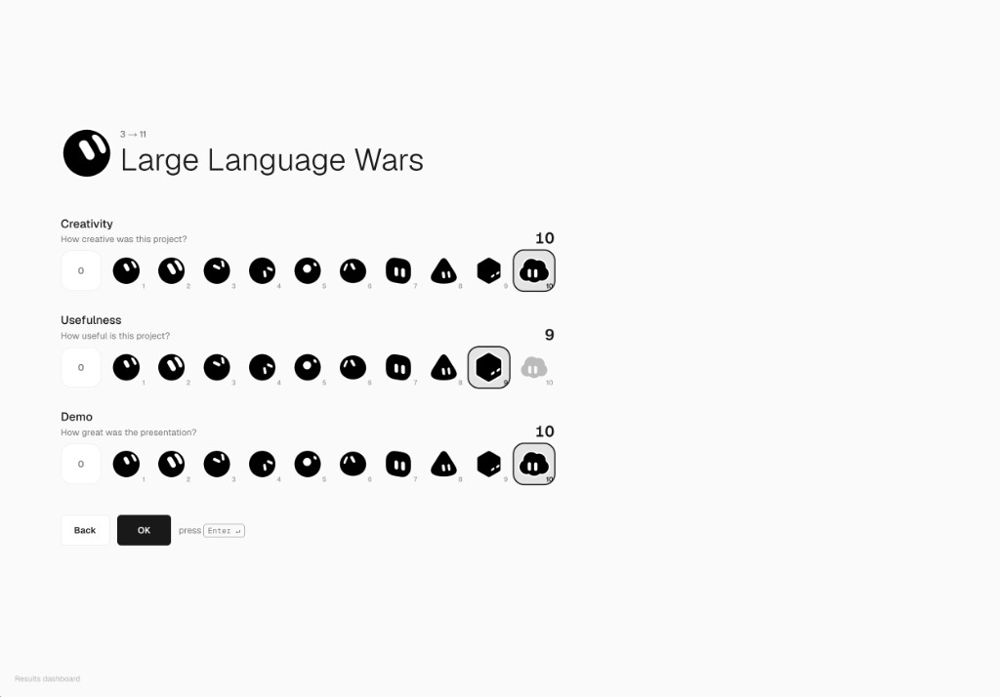
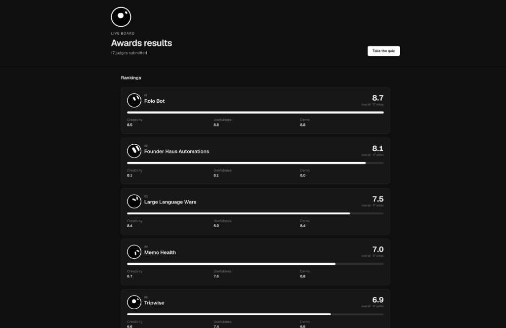

# Awards evaluation quiz

Judges score each project on **Creativity**, **Usefulness**, and **Demo**. The results page ranks the projects by the average of those three scores.

Created by [@aferrari](https://x.com/aferrari) and [@cristianmock](https://x.com/cristianmock). Free to use and repurpose under the [MIT License](LICENSE).

**Example:** [results board](https://grokbot-awards-form.vercel.app/results) · [quiz](https://grokbot-awards-form.vercel.app)

## The quiz



One project per screen. The judge picks 0–10 for each question, then presses **OK** or **Enter**.

## The results



Anyone with the link can open this page. It shows the average of every submitted ballot. It does not show one judge's scores.

## How it works

1. The organizer writes two lists: the projects, and the email addresses allowed to vote.
2. A judge opens the quiz and enters their email. The app accepts the vote only if that email is on the list and has not voted yet.
3. The judge scores every project. Creativity, Usefulness, and Demo are each a number from 0 to 10. The overall score is the average of those three.
4. On the last project, the judge submits. That email cannot vote again.
5. The results page sorts projects from the highest overall score to the lowest.

A quiz can hold up to 40 projects. Up to 500 emails can be allowed.

Updating the email list leaves existing votes in place. Replacing the project list deletes every saved vote, because each ballot has to match the current list of projects.

## How to use it

### Organizer

1. Open `/setup`.
2. Enter the admin secret. This is the `ADMIN_SECRET` on the server, not a judge's email.
3. Paste judge emails, one per line, and save that list.
4. Paste projects, one per line. A description can follow a pipe:

```
Inbox Triage | Sorts support mail into a daily brief
Standup Bot
Research Desk | Pulls sources before a meeting
```

5. Create the quiz, then confirm. Share `/` with the judges and `/results` with everyone else.

### Judge

1. Open the quiz link.
2. Enter an email from the allowed list. The app does not send invitations. It only checks that the address is allowed and has not voted yet.
3. Score Creativity, Usefulness, and Demo for each project. Press **Enter** to continue, or **Back** to change the previous project.
4. Submit on the last project.

### Anyone else

Open `/results`. No login. The page shows each project's overall score, the three averages, and how many judges have submitted.

## Credits

- **App:** [@aferrari](https://x.com/aferrari) and [@cristianmock](https://x.com/cristianmock), 2026.
- **Score icons:** the black-and-white Grok bot stickers from [xAI](https://x.ai), in `public/bots`. Those drawings are xAI's. Replace them if you republish the app under another name.
- **Built with:** Next.js, React, Neon Postgres, and Tailwind CSS.

Report a security problem to the repository owners. See [SECURITY.md](SECURITY.md).

## License

[MIT](LICENSE). Copyright (c) 2026 aferrari and cristianmock.

You can use this app, change it, and ship your own version, including for a paid event. Keep the copyright notice and the license text with the code. The Grok bot stickers are not covered by this license.

## Run your own copy

You need Node.js 20.9 or newer and your own [Neon](https://neon.tech) Postgres database. This repository does not connect to the authors' database. A new database starts empty.

```bash
npm install
cp .env.example .env.local
```

| Variable | Purpose |
| --- | --- |
| `DATABASE_URL` | Your Neon connection string. |
| `ADMIN_SECRET` | The password for `/setup`. Generate one with `openssl rand -base64 32`. |

```bash
npm run dev
```

Open http://localhost:3000/setup, create the quiz, vote at http://localhost:3000, then open http://localhost:3000/results.

Do not commit `.env.local`. If the quiz says the database is not configured, set `DATABASE_URL` and restart `npm run dev`.

### Deploy

**Vercel.** Import this repo into your own Vercel account, set `DATABASE_URL` and `ADMIN_SECRET`, and deploy. Then open `/setup` on your domain.

**Your own server.**

```bash
npm install
npm run build
npm run start
```

The server listens on port 3000.

### API

Admin calls send `Authorization: Bearer <ADMIN_SECRET>`.

| Method | Path | Who | What it does |
| --- | --- | --- | --- |
| `GET` | `/api/quiz` | Anyone | Project list. No emails. |
| `GET` | `/api/quiz` | Admin | Project list and allowed emails. |
| `POST` | `/api/quiz` | Admin | Replace the projects. Deletes saved votes. |
| `POST` | `/api/voters` | Admin | Replace the email list. Votes stay. |
| `POST` | `/api/eligibility` | Anyone | Check whether an email can vote. |
| `POST` | `/api/submissions` | Allowed judge | Save one ballot. |
| `GET` | `/api/results` | Anyone | Averages and rankings. No per-judge scores. |

Replace the quiz:

```json
{
  "projects": [{ "name": "Standup Bot", "description": "Optional" }],
  "allowedEmails": ["judge@example.com"]
}
```

Replace only the email list:

```json
{ "allowedEmails": ["judge@example.com"] }
```
